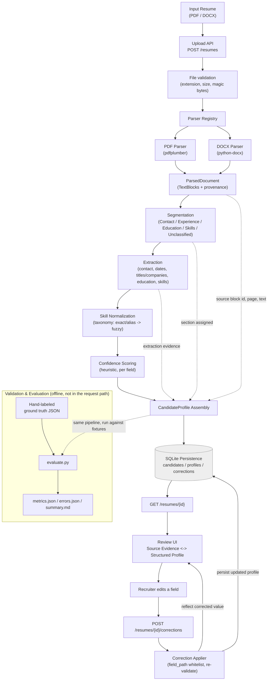

# Architecture

## System diagram

Read top to bottom for the request-time path (upload through correction);
the bottom subgraph is a separate, offline process that runs the same
pipeline against a fixed, hand-labeled fixture set to produce the
precision/recall/F1 numbers in `docs/TECHNICAL_REPORT.md` -- it does not
run as part of handling a real upload.

**Provenance flow** (dotted edges above): the parser attaches a source
block ID, page number (PDF only -- always `None` for DOCX, never
fabricated), and the original text to every `TextBlock`; segmentation
records which section each block was assigned to; extraction records
*how* a value was derived (method, match strength, ambiguity). All three
survive into the assembled `CandidateProfile` as each field's
`Provenance` + `ExtractionEvidenceSummary`, which is what the Review UI
reads to show "why did the system say this" next to every field, and
what a recruiter's correction request is checked against.

**Recruiter review loop**: `GET /resumes/{id}` → Review UI renders the
source evidence pane and the structured profile pane from the same
response → a correction submitted through the UI hits
`POST /resumes/{id}/corrections`, which is validated and applied against
the *stored* profile (not just logged) → the endpoint returns the updated
profile so the UI reflects the persisted result without a second `GET`.

## Replaceable interfaces

- `ResumeParser` + `ParserRegistry` (`parsing/base.py`) -- add a new input
  format by implementing one class and registering it by extension.
- `FieldExtractor` (`extraction/base.py`) -- add or swap an extraction
  approach per field family without touching other stages.
- `CandidateRepository` (`persistence/repository.py`) -- SQLite is the MVP
  implementation (`persistence/sqlite_repository.py`); a future store is a
  new class behind the same interface.
- `FileStorage` (`storage/file_storage.py`) -- local disk is the MVP
  implementation; cloud storage later is a new class behind the same
  interface.

## Never-silently-discard guarantee

- `ParsedDocument.parser_warnings` -- a parser records what it couldn't
  confidently place instead of dropping it.
- `ResumeSection.UNCLASSIFIED` -- segmentation puts unmatched blocks in an
  explicit bucket rather than discarding them.
- `CandidateProfile.unclassified_text` -- the same guarantee surfaces in
  the final structured output.
- A correction that fails validation never partially persists
  (`corrections/applier.py` validates and re-validates the whole profile
  before any write).

## Persistence (SQLite)

Four tables (`candidates`, `candidate_profiles`, `corrections`,
`review_state`) -- see `persistence/models.py` for the schema. Uploaded
resume files themselves are stored on local disk under a server-generated,
collision-free filename (`security/filenames.py`), never under the
client-supplied name.

## Parsing (PDF: pdfplumber, DOCX: python-docx)

PDF reading order is reconstructed rather than trusted from raw word
order: tables are detected and extracted separately first (excluded from
the plain-text word stream so content isn't duplicated), remaining words
are assigned to one or two column bands via a horizontal-gap heuristic,
grouped into lines by vertical proximity, and columns/tables are then
merged column-by-column, each ordered top-to-bottom. Headings are guessed
from font size/boldness relative to the page's median body text.

DOCX paragraphs and tables are walked in true document order (python-docx
doesn't expose this directly -- see `_iter_block_items` in
`docx_parser.py`), and headings are read from the paragraph's Word style
rather than guessed.

Known limitations: PDF column detection only distinguishes single- vs.
two-column layouts (3+ columns fall back to one band -- content is still
emitted, just without finer column ordering); PDF line grouping uses a
fixed vertical tolerance rather than a detected line-height; DOCX has no
page concept without rendering, so DOCX `TextBlock.page_number` is always
`None`.

## Section segmentation

Heading-based state machine (walks blocks in parser-produced order,
switching the "current section" at each recognized heading) layered with:
content-based fallbacks (date ranges → Experience, degree keywords →
Education, short comma-lists → Skills) for content with no heading at
all, and content-based contact detection (email, phone, **and URL**
patterns) that applies regardless of heading state -- this last check
initially covered only email/phone; a small validation-discovered gap
(a standalone LinkedIn/GitHub link line was never routed to Contact) was
fixed by adding the existing `URL_RE` pattern to the same check (see
`docs/TECHNICAL_REPORT.md`'s error analysis). Heading recognition itself
is two-tier: exact phrase match against known variants, then a broader
keyword-stem match restricted to heading-*looking* blocks, to generalize
without false-positiving on body text. See `segmentation/segmenter.py`'s
module docstring for the full strategy.

## Entity/field extraction

Hybrid approach, per field family:

- **Contact** (`extraction/contact.py`): deterministic regex for
  email/phone/URL; a light shape-based heuristic (first short,
  non-email/phone/URL Contact-section block) for full name, explicitly
  flagged lower-confidence since it has no structural guarantee.
- **Dates** (`extraction/dates.py`): deterministic regex supporting
  MM/YYYY, "Month YYYY", YYYY, YYYY-YYYY (hyphen/en-dash/em-dash/"to"),
  and open-ended "... to Present/Current". Only runs against blocks
  already in Experience/Education -- that section membership is the
  contextual evidence that keeps a bare year in unrelated text from being
  treated as an employment date.
- **Job titles / companies** (`extraction/titles_companies.py`): strip
  dates, split on comma/" at ", then classify each segment via a curated
  title-keyword list and company-suffix list first, with spaCy ORG
  detection as a weaker *supporting* signal only. Validation found one
  concrete failure mode of this design: an ordinary word that happens to
  match a company-suffix keyword (e.g. "systems", meant for names like
  "Acme Systems") can misclassify a whole sentence as a company.
- **Education** (`extraction/education.py`): degree-phrase regex
  (ordered most-specific-first) locates the degree; an "in <Field>"
  pattern captures field of study; institution comes from an
  institution-keyword list, with spaCy ORG as a weaker fallback signal.
- **Skills** (`extraction/skills.py`): Skills-section content is split
  and trusted at face value (the recruiter's own categorization is the
  strongest signal available) -- this also means a Skills-section
  *table*'s header/rating cells ("Level", "Expert") get extracted as skill
  candidates too, a known, quantified limitation. Experience/Unclassified
  text is scanned only against a curated seed list of common technology
  terms -- deliberately conservative, to avoid extracting ordinary
  English words.

Every `RawExtraction` carries an `ExtractionEvidence` (method, section,
matching strength, whether signals agreed, an ambiguity flag/reason) that
confidence scoring consumes -- never a fabricated numeric confidence at
this stage.

## Skill normalization

Curated taxonomy (`data/taxonomy/skills_taxonomy.json`, ~110 entries,
generated by `scripts/build_skill_taxonomy.py`) matched via
`normalization/normalizer.py`'s `SkillNormalizer`, two tiers:

1. Exact/alias lookup after normalization that strips separator
   punctuation (whitespace, hyphen, dot, underscore, slash) but keeps
   meaningful symbols like `+`/`#` -- stripping *all* punctuation was
   found (via testing) to collapse "C++" and "C#" to the same lookup key,
   silently shadowing one entry.
2. Fuzzy matching (rapidfuzz, token-sort ratio) above an 85/100
   threshold, skipped for raw values under 4 characters to avoid noisy
   short-abbreviation collisions (e.g. "AI" scoring deceptively close to
   "AWS" on shared letters alone).

A skill matching neither tier comes back as `matched_entry=None` --
unmatched, not dropped, not force-matched. The threshold is a judgment
call, not derived from a labeled validation set.

## Confidence scoring

`confidence/scorer.py`'s `HeuristicConfidenceScorer` turns each field's
`ExtractionEvidence` into a bounded `[0.0, 1.0]` score using documented,
hand-tuned weights per extraction method/match-strength, minus flat
penalties for ambiguity/signal disagreement. `needs_review` is a single
rule applied everywhere: `confidence < review_threshold` (default 0.6,
configurable). Skill normalization gets its own, separately-scored
`normalization_confidence` (never blended with extraction confidence --
they answer different questions).

**This is an explainable engineering heuristic, not a calibrated
probability model** -- no labeled dataset was used to fit these weights.
See `docs/TECHNICAL_REPORT.md`'s confidence-sanity-check section for what
validation does and does not say about how well `needs_review` tracks
actual correctness.

## Pipeline orchestrator and CandidateProfile assembly

`pipeline/orchestrator.py`'s `ResumeProcessingPipeline.process(file_path)`
runs the full chain synchronously -- ingestion → parsing → segmentation →
extraction → normalization → confidence scoring → assembly -- returning a
`ProcessingResult` (`status="completed"` + `profile`, or `status="failed"`
+ a safe `error_message`), never a bare exception or a fabricated
profile.

`pipeline/assembly.py` turns the flat `list[RawExtraction]` into a
`CandidateProfile`:

- **Experience/education** entries are grouped by **source block ID**,
  not by company/institution name -- two roles at the same employer
  (different blocks) correctly produce two entries; a block-internal date
  range is split into start/end, with an open "... to Present/Current"
  range setting `is_current=True` and leaving `end_date` unset.
- **Skills** are deduplicated by **canonical name** once normalized (so
  "ML" and "Machine Learning" collapse into one entry with both raw
  mentions preserved), or by exact raw text when unmatched.
- **Contact** singular fields (name/email/phone) take the first
  occurrence in document order; URLs are deduplicated by exact value and
  kept as a list.
- **Unclassified** content passes through unchanged from segmentation's
  `UNCLASSIFIED` bucket into `CandidateProfile.unclassified_text`.

Every `ScoredField`/`SkillMention` carries a `Provenance` (section,
source block IDs, page numbers, original text) and an
`ExtractionEvidenceSummary` mirroring the originating extraction's
evidence -- the data the Review UI reads to answer "where did this come
from."

## Correction application (`corrections/applier.py`)

`POST /resumes/{id}/corrections` does not blindly trust a client-supplied
`field_path`. It's checked against an explicit, closed whitelist of
correctable path templates (e.g. `contact.email.value`,
`skills[0].canonical_name`, `experience[0].company.value`) -- unknown
fields, out-of-range list indices, and blank values are all rejected
before anything is touched. A valid correction is applied to an in-memory
copy of the stored profile, the *whole* profile is re-validated against
the Pydantic schema, and only then is it persisted, together with an
audit-log row recording the original value. The corrected field's
`needs_review` is cleared; its `confidence` is left untouched as a
historical record of the original machine read.

## API integration

`POST /resumes` runs the pipeline synchronously after storing the file:
`uploaded` → `processing` → `completed` (profile persisted as JSON) or
`failed` (safe `error_message` persisted, no stack trace/path).
`GET /resumes/{id}` returns the persisted status, `processing_error` (if
any), and profile. `POST /resumes/{id}/corrections` returns the updated
profile plus the value it replaced.

## Validation & evaluation layer

Deliberately kept outside the request-time pipeline: `validation/`
holds a hand-labeled ground-truth set (`ground_truth/*.json`) and a
standalone script (`evaluate.py`) that runs the *same*
`ResumeProcessingPipeline` against the fixtures those labels describe,
scores the result with strict (non-fuzzy) matching rules, and writes
`results/metrics.json`, `results/errors.json`, and `results/summary.md`.
It shares code with nothing else in the request path -- it exists purely
to produce honest, reproducible accuracy numbers and a categorized error
log. See `docs/TECHNICAL_REPORT.md` for the full methodology and results,
and `validation/README.md` for how to re-run it.

## Recruiter review UI

A separate React + Vite + TypeScript app (`review-ui/`), calling the API
above over JSON. Built around a SOURCE ↔ PROFILE split: a left pane
reconstructed from every field's captured provenance text, and a right
pane of the structured, editable profile with confidence/`needs_review`
indicators and a review-progress meter. See `review-ui/README.md` for
the full design rationale and its own known limitations (e.g. no
rendered PDF/DOCX preview -- the source pane is built from provenance
text, since no endpoint serves the raw file).
